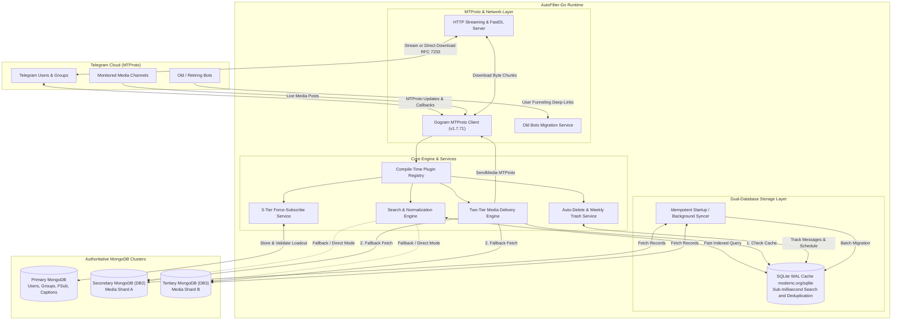
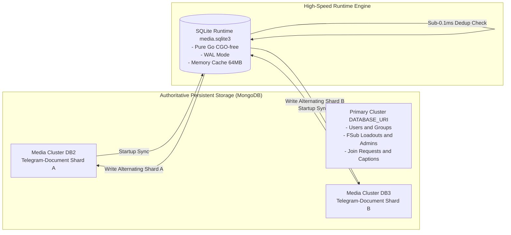
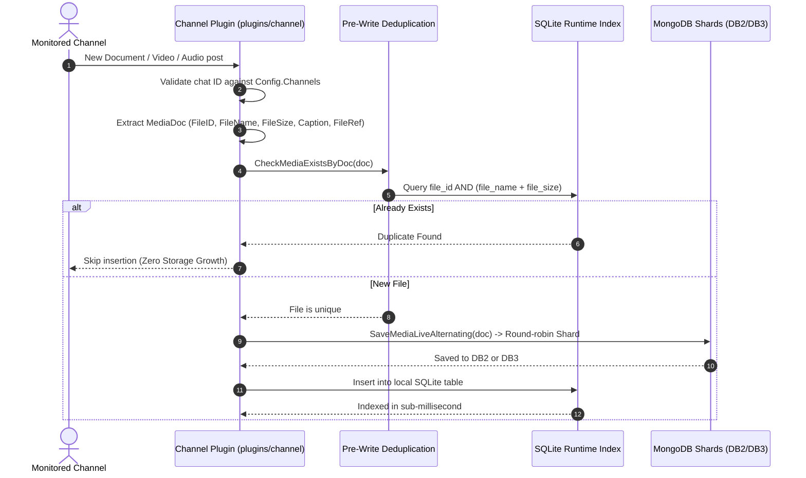
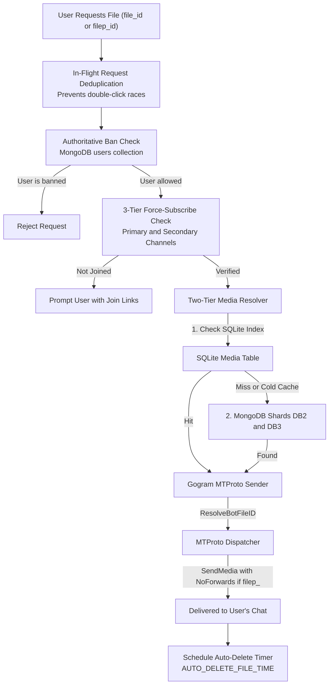

# AutoFilter-Go System Architecture

This document provides a comprehensive technical overview of the architecture, design patterns, and internal data flow of **AutoFilter-Go**.

---

## 1. High-Level System Architecture

AutoFilter-Go uses a multi-tiered architecture that combines Telegram MTProto networking, multi-cluster MongoDB persistent storage, a CGO-free pure-Go SQLite runtime index, and a built-in HTTP streaming server.

---

## 2. Telegram Networking Layer (Gogram MTProto)

Unlike standard Telegram bots that communicate over HTTP using the Telegram Bot API webhook or polling mechanism, AutoFilter-Go directly implements Telegram's **MTProto binary protocol** via [`github.com/amarnathcjd/gogram`](https://github.com/amarnathcjd/gogram) (pinned to v1.7.71).

### Key Advantages of Native MTProto
- **No HTTP Webhook Bottlenecks**: Full-duplex persistent TCP connection to Telegram Datacenters (DCs).
- **Direct Bot API File ID Resolution**: Employs `telegram.ResolveBotFileID` to resolve Bot API `file_id` strings directly into native MTProto `InputDocument` or `InputPhoto` structures without making external API round-trips.
- **Protected Content Delivery**: Natively supports the `NoForwards: true` parameter at the MTProto protocol level, preventing media saving and forwarding when requested.
- **Concurrent Client Execution**: Supports running the main bot alongside arbitrary numbers of legacy bots (`internal/oldbot`) simultaneously without interfering with event loops.

---

## 3. Database Architecture & Storage Sharding

AutoFilter-Go implements a hybrid, multi-database architecture designed to handle hundreds of thousands of media files while keeping query latency under 1 millisecond.

### 1. Primary MongoDB Cluster (`DATABASE_URI`)
- **Exclusively reserved for application state**:
  - `users`: Tracks registered users, profile snapshots, and ban statuses.
  - `groups`: Tracks connected groups and chat enabled/disabled flags.
  - `admins`: Stores Force-Subscribe channel configuration, routing thresholds, and custom captions.
  - `reqone`, `reqtwo`, `reqthree`: Tracks pending join requests for FSub channels.
- **Isolation**: In standard multi-database configurations, the primary database does **not** store media file records. This eliminates index bloat on user tables.

### 2. Secondary & Tertiary MongoDB Shards (`DATABASE_URI2`, `DATABASE_URI3`)
- **Sharded Media Storage**: Media files are balanced across two authoritative MongoDB clusters (`DB2` and `DB3`).
- **Round-Robin Alternation**: When live media is indexed from monitored channels (`plugins/channel`), the bot alternates write operations between `DB2` and `DB3`, halving per-cluster storage and I/O consumption.
- **Single-Database Compatibility**: If `DATABASE_URI2` and `DATABASE_URI3` are not provided, the database manager automatically falls back to `DATABASE_URI` without breaking functionality.

### 3. Pure-Go SQLite Runtime Engine (`internal/database/sql`)
- **Engine**: Implemented via `modernc.org/sqlite`, a 100% CGO-free, pure-Go SQLite implementation. Requires no GCC toolchains, no external C libraries, and cross-compiles effortlessly.
- **Write-Ahead Logging (WAL)**: `PRAGMA journal_mode=WAL` allows simultaneous concurrent readers while writes execute.
- **Memory Tuning**: `PRAGMA cache_size=-64000` allocates 64MB of RAM for the SQLite page cache, enabling in-memory index evaluation.
- **Zero-Sync Mode (`ENABLE_SYNC=false`)**: For users who prefer zero local disk usage or want sub-second bot booting, setting `ENABLE_SYNC=false` allows the bot to boot in 1 second and query authoritative MongoDB directly with ~50MB RAM consumption.

---

## 4. Live Media Indexing Pipeline

When an administrator posts or forwards media into a monitored channel, AutoFilter-Go ingests and indexes it through the following pipeline:

---

## 5. Search Engine & Query Normalization

The search service (`internal/search`) handles ambient movie searches in public and private groups:

1. **Tokenization & Sanitization**:
   - Strips common uploader tags, channel mentions, bracketed watermarks (e.g. `[1TamilMV]`, `@CinemaCourt`, `HDRip`).
   - Normalizes Unicode punctuation (replacing dots, underscores, dashes with spaces).
2. **Search Matching**:
   - Multi-word fuzzy and prefix matching across `file_name` and `caption`.
   - SQLite indexed queries execute in `<0.5ms`.
3. **Language & Quality Filters**:
   - Matches keywords against supported qualities (`480P`, `720P`, `1080P`, `2160P`, `4K`).
   - Matches keywords against supported audio tracks (`Malayalam`, `Tamil`, `English`, `Hindi`, `Telugu`, `Kannada`, `Multi`).
4. **Interactive Pagination & Session State**:
   - Groups results into pages of 8 files per message.
   - Maintains search session cache to resolve subsequent page buttons and language filters without re-evaluating full queries.

---

## 6. Two-Tier Media Delivery Pipeline

When a user requests a file via `/getfile`, an inline result button, or a deep-link `/start file_<id>`:

---

## 7. HTTP Streaming & Fast Download Server

The built-in HTTP server (`internal/stream`) provides fast downloads and streaming:

- **RFC 7233 Byte-Range Serving**: Video files can be seeked instantly forward and backward in VLC, MX Player, or any web browser without downloading the full file first.
- **HMAC-SHA256 URL Signatures**: Links are cryptographically signed with an expiration timestamp (`FAST_DOWNLOAD_LINK_EXPIRY`), preventing link hijacking and unauthorized hotlinking.
- **M3U Playlist Endpoint**: Endpoints `/playlist/:id` and `/m3u/:id` return standard media playlists that can be opened directly in streaming video players.
- **HTML5 Player**: The `/watch/:id` route renders a lightweight, responsive web player with streaming playback controls.

---

## 8. Graceful Lifecycle & Signal Handling

AutoFilter-Go uses a centralized application container (`internal/app/app.go`):

1. **Startup**:
   - Configures runtime memory and CPU limits (`initRuntimeTuning`).
   - Validates environment configuration (`config.LoadFromEnv`).
   - Initializes structured logger (`slog`).
   - Connects to SQLite and MongoDB clusters (`database.DatabaseManager`).
   - Starts HTTP streaming server (`internal/stream`).
   - Launches legacy bot migration workers (`internal/oldbot`).
   - Registers all compile-time plugins (`RegisterPlugins`).
   - Connects to Telegram MTProto datacenter.
2. **Shutdown**:
   - Intercepts `SIGINT` (Ctrl+C) and `SIGTERM`.
   - Disconnects all legacy bot clients.
   - Gracefully shuts down HTTP streaming server.
   - Commits active SQLite WAL logs and closes database handles.
   - Disconnects MongoDB client connections.
   - Disconnects Gogram MTProto client.

